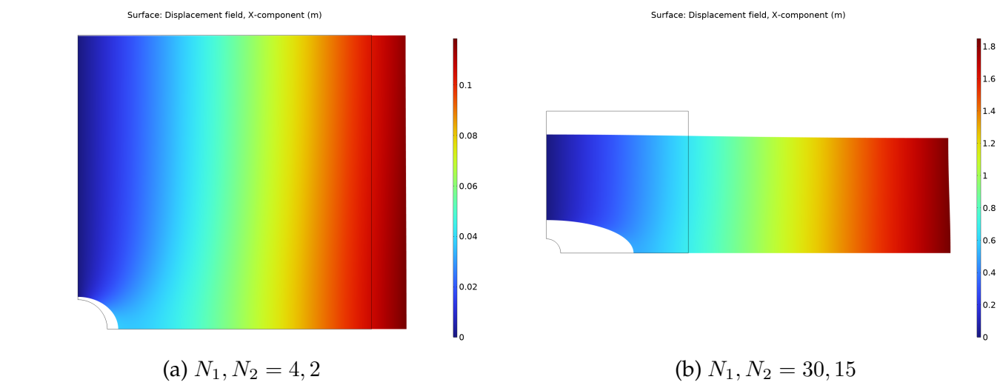
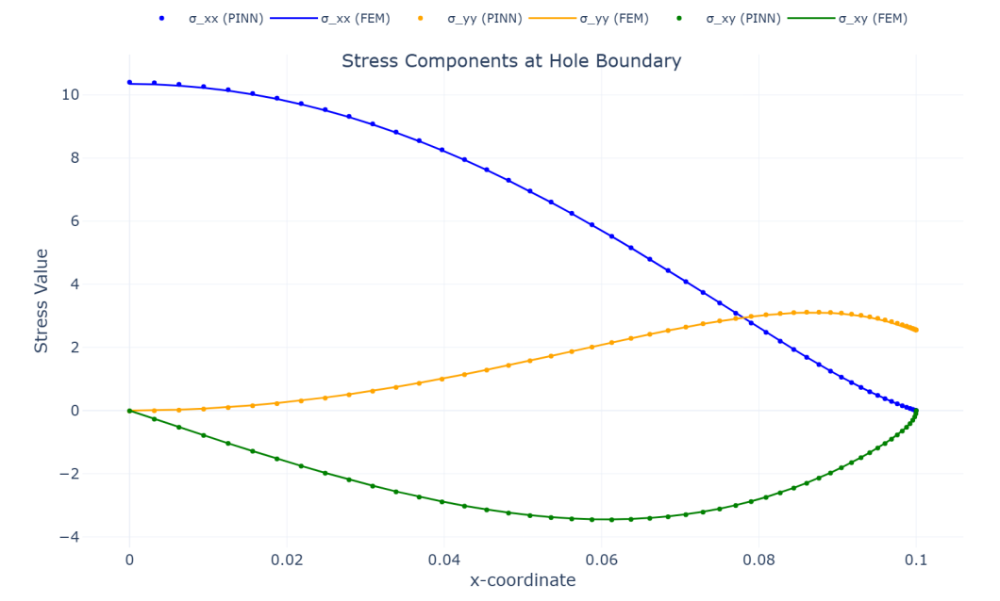
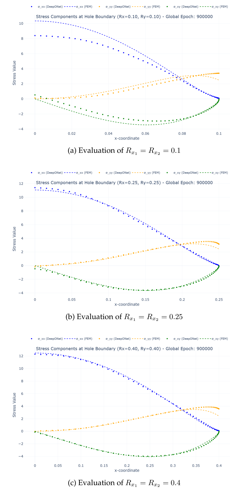

# Physics-informed learning for large deformations

**PINNs and PI-DeepONet for finite-strain hyperelasticity | PyTorch · DeepXDE · COMSOL validation**

Can a neural network predict how a nonlinear elastic plate deforms using the governing physics instead of labeled training data? Can one model also learn how the solution changes with the hole geometry?

This repository investigates both questions through a master's thesis project by **Marc Schwager**, Materials Science and Engineering, **University of Augsburg**. It combines continuum mechanics, automatic differentiation, neural-network training, and finite-element validation for a biaxially loaded Neo-Hookean plate.


*FEM reference solutions: increasing the applied traction from (4, 2) to (30, 15) produces strongly nonlinear deformation. Extracted from thesis Figure 4.2; these are COMSOL results, not neural-network predictions.*

## What this project does

- **Fixed-geometry PINN:** learns a displacement field for a plate with a circular hole, with independent implementations in PyTorch and DeepXDE.
- **Geometry-dependent PI-DeepONet:** combines a branch network for elliptical-hole semi-axes with a trunk network for spatial coordinates to predict displacement across varying geometries.
- **Physics-based training:** enforces equilibrium and displacement/traction boundary conditions; stress is derived from displacement through automatic differentiation and a compressible Neo-Hookean constitutive law.
- **FEM validation:** compares predicted displacement and stress fields with COMSOL reference data, including the hole boundary where stress gradients are highest.
- **Training experiments:** explores random Fourier features, sampling, adaptive loss weighting, learning-rate scheduling, and geometry batching.

## Physical problem and method

The computational domain is a unit square with a quarter-circular or quarter-elliptical cutout at its bottom-left corner. Plane strain is assumed. Symmetry-type displacement constraints are applied at the left and bottom edges, biaxial tractions at the right and top edges, and zero traction at the hole boundary.

The fixed circular-hole case uses radius **0.1**, Lamé parameters **λ = 20** and **μ = 10**, and traction pairs **(N₁, N₂) = (4, 2)** or **(30, 15)**. The operator-learning experiment samples both elliptical semi-axes independently in **[0.1, 0.4]** for the **(4, 2)** loading case.

The networks predict displacement components. The deformation gradient determines the constitutive stress, and automatic differentiation evaluates the equilibrium residual **Div P = 0**. Training minimizes this residual together with boundary-condition losses. The FEM CSVs are used for evaluation rather than as labeled training targets.

## Selected thesis results

The figures and numbers below are **reported thesis results**, not fresh benchmark runs. Saved notebook settings may differ from the individual configurations used in the thesis.


*Fixed circular hole, loading (4, 2), initial configuration after 200,000 epochs. PINN and FEM stress profiles closely agree (thesis Figure 5.1).*

For this fixed-geometry case, the reported Cauchy stress WMAPE was **0.24% / 0.82% / 1.80%** across the domain and **0.56% / 0.95% / 0.75%** along the hole boundary for the xx / yy / xy components (thesis Table 5.1). Displacement WMAPE was **0.77% in x** and **13.75% in y**; the latter illustrates why relative error should be interpreted alongside absolute error when reference displacement is small.


*Improved PI-DeepONet after 900,000 epochs, evaluated at equal semi-axes of 0.10, 0.25, and 0.40 (thesis Figure 7.3).*

| Equal hole semi-axes | Hole stress WMAPE xx | yy | xy |
| --- | ---: | ---: | ---: |
| 0.10 | 15.671% | 18.911% | 18.217% |
| 0.25 | 3.063% | 11.989% | 5.674% |
| 0.40 | 2.436% | 14.358% | 4.498% |

*Thesis Table 7.2, loading (4, 2). WMAPE = 100 × sum of absolute errors / sum of absolute reference values.*

The geometry-dependent model improves on the initial implementation but remains less accurate than the fixed-geometry PINN, particularly at the smallest hole size. This is a research implementation with demonstrated limitations in operator generalization, training stability, and computational cost. The thesis reports about two weeks of training on an RTX 8000 for the 900,000-epoch PI-DeepONet experiment.

## Repository guide

| File | Purpose |
| --- | --- |
| [`PINN_NeoHooke_Hole_Plate_PyTorch.ipynb`](PINN_NeoHooke_Hole_Plate_PyTorch.ipynb) | Start here: explicit PyTorch PINN, sampling, mechanics, training, and evaluation. |
| [`PINN_NeoHooke_Hole_Plate_DeepXDE.ipynb`](PINN_NeoHooke_Hole_Plate_DeepXDE.ipynb) | Alternative PINN implementation using DeepXDE with its PyTorch backend. |
| [`DeepONet_NeoHooke_Elliptical_Hole_Plate_PyTorch.ipynb`](DeepONet_NeoHooke_Elliptical_Hole_Plate_PyTorch.ipynb) | Physics-informed operator learning with varying elliptical-hole geometry. |
| [`data/`](data/) | Exported FEM reference CSVs for the two load cases and selected hole sizes. |
| [`COMSOL_Reference_Model.mph`](COMSOL_Reference_Model.mph) | COMSOL reference model; opening or rerunning it requires COMSOL Multiphysics. |

## Getting started

These are exploratory research notebooks with saved outputs. Read the output cells to inspect examples before starting a long training run.

```bash
git clone https://github.com/schwager-marc/PINN-and-PI-DeepONet-for-hyperelastic-deformations.git
cd PINN-and-PI-DeepONet-for-hyperelastic-deformations
python -m venv .venv
# Activate .venv using the command for your shell.
python -m pip install torch numpy scipy matplotlib plotly tqdm deepxde jupyterlab
jupyter lab
```

This dependency list is derived from notebook imports; package versions were not pinned in the original research environment. GPU training requires a PyTorch installation compatible with the machine's CUDA setup. The notebooks select CUDA when available and otherwise fall back to CPU.

Before running:

1. Open the PyTorch PINN notebook first and execute cells deliberately in order. The notebooks contain experimental and alternative training cells, so review them before using **Run All**.
2. Replace the original absolute Windows CSV paths in the setup cells with repository-relative paths. For the default PINN loading (4, 2), use `file_path = 'data/Hooke_hole-coupled-4-2-r10.csv'`. For (30, 15), use `data/Hooke_hole-coupled-30-15-r10.csv` and change the applied tractions consistently.
3. In the DeepONet notebook, set `file_path10`, `file_path25`, and `file_path40` to the corresponding files in `data/`: `Hooke_hole-coupled-4-2-r10.csv`, `Hooke_hole-coupled-4-2-r025.csv`, and `Hooke_hole-coupled-4-2-r040.csv`.
4. The PyTorch PINN includes commented-out checkpoint-loading code for `best_model.pth`. That checkpoint is not included; keep the loading code disabled for training from scratch. Checkpoint-saving calls in the training code are also commented out and can be enabled if you want to retain a trained model.
5. For DeepXDE, select its PyTorch backend **before importing `deepxde`**. For example, insert `import os; os.environ['DDE_BACKEND'] = 'pytorch'` above the import, then restart the kernel if DeepXDE was already imported.
6. Reduce the training budget for an initial smoke run. The PINN defaults to 200,000 epochs; the DeepONet adjusts its loop count using `ITERATIONS`, so inspect both values. A short run checks execution only and will not reproduce thesis accuracy.

Existing reference CSVs allow evaluation without running COMSOL. No pretrained checkpoint or complete environment lockfile is included, and the published notebooks should not be assumed to reproduce every thesis result without matching its settings and training budget.

## Research context

Marc Schwager, *PINNs for large scale deformations*, master's thesis, Materials Science and Engineering, University of Augsburg, November 2025. Supervisors/examiners: Prof. Dr. Nils Meyer and Prof. Dr. Philipp Lechner.

The selected figures were extracted from the supplied thesis. This repository presents scientific machine learning, nonlinear solid mechanics, custom PyTorch training, framework comparison, and validation against a numerical reference.
